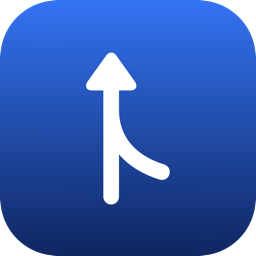
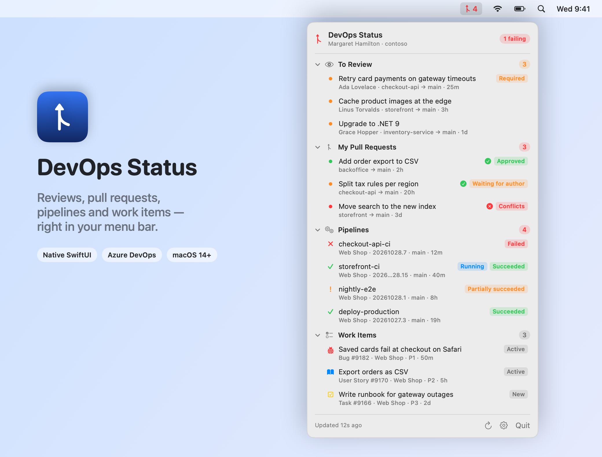
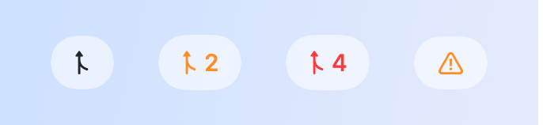
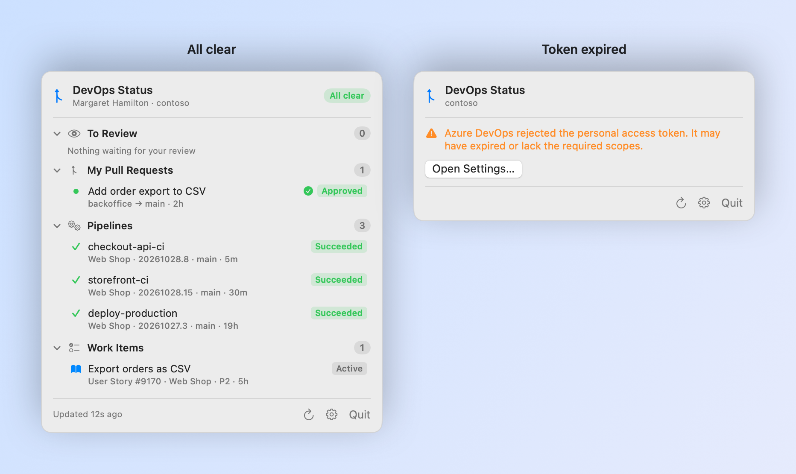
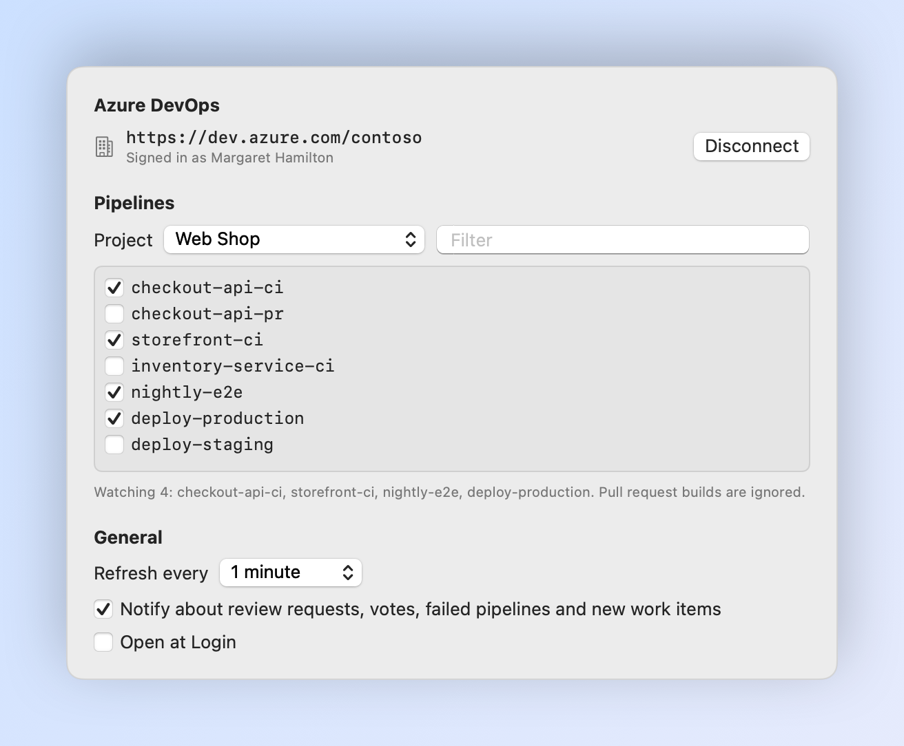
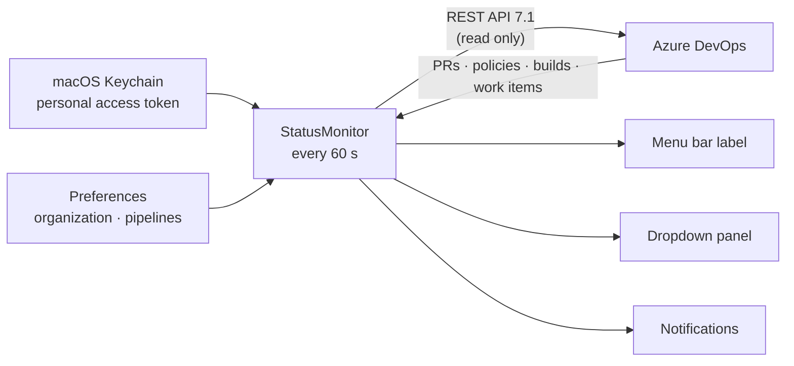

<div align="center">



# DevOps Status

**Pull requests waiting for you, your own PRs, pipelines and work items from Azure DevOps — live in the macOS menu bar.**

[](https://github.com/recepysl/devops-status/actions/workflows/ci.yml)
[](https://github.com/recepysl/devops-status/releases/latest)


[](LICENSE)

[**Download**](https://github.com/recepysl/devops-status/releases/latest) ·
[Features](#-features) ·
[How it works](#-how-it-works) ·
[Build from source](#-build-from-source) ·
[Architecture](docs/ARCHITECTURE.md)

<br>

<picture>
  <source media="(prefers-color-scheme: dark)" srcset="docs/images/hero-dark.png">
  
</picture>

</div>

## Why

A review request sits unnoticed for half a day. The CI build on `main` has been red since lunch. A reviewer asked for changes on your pull request an hour ago. Azure DevOps knows all of it — but only tells you if you keep a browser tab open and keep refreshing it, or dig through e-mail.

**DevOps Status** keeps it in one place you already look at: a small icon in the menu bar with a count of what needs you, and the full list one click away.

## ✨ Features

|   |   |
| --- | --- |
| 👀 **To review** | Active pull requests where you are a reviewer and haven't voted yet, across every project in the organization. Required reviews are marked. |
| 🔀 **My pull requests** | Each of your active PRs with its review state (approved, waiting for author, rejected, *n/m approved*), merge conflicts and the build policy result. |
| 🚦 **Pipelines** | The latest CI run of the pipelines you pick — failed, partially succeeded, succeeded, and whether a new run is in progress. Pull request builds are ignored. |
| ✅ **Work items** | Open work items assigned to you, newest activity first, with type, state and priority. |
| 🔔 **Notifications** | A native notification when someone requests your review, votes on your PR, a watched pipeline fails, or a work item is assigned to you. Click it to open the item. |
| 🔢 **Menu bar badge** | Pending reviews plus failed pipelines. Orange when something waits for you, red when a pipeline failed or one of your PRs is rejected or conflicting. |
| 🖱 **One click away** | Every row opens in the browser; right-click to copy its link. |
| 🔐 **Token in the Keychain** | A read-only personal access token, stored in the macOS Keychain and only ever sent to your organization. |
| 🛜 **Resilient** | Each section fails independently, and the last good data stays on screen (marked offline) when the network drops. |
| 🚀 **Open at Login** | Uses `SMAppService`; turned on automatically the first time you launch it from `/Applications`. |
| 🪶 **Tiny & native** | Swift and SwiftUI, zero dependencies, no Dock icon, no Electron. |

## 🎨 States

<picture>
  <source media="(prefers-color-scheme: dark)" srcset="docs/images/menubar-dark.png">
  
</picture>

<picture>
  <source media="(prefers-color-scheme: dark)" srcset="docs/images/states-dark.png">
  
</picture>

> Every screenshot in this README is rendered by the app itself from demo data — run `make screenshots` to regenerate them.

## 📦 Install

**Requirements:** macOS 14 Sonoma or later, and an Azure DevOps Services organization (`dev.azure.com/<org>` or `<org>.visualstudio.com`). Azure DevOps Server collections (`https://server/tfs/<collection>`) work as long as they support REST API 7.1.

**One-line install (recommended)** — downloads the latest release into `/Applications` and launches it:

```bash
curl -fsSL https://raw.githubusercontent.com/recepysl/devops-status/main/scripts/install.sh | bash
```

**Or install manually:**

1. Download the latest **`DevOpsStatus-x.y.z.dmg`** from [Releases](https://github.com/recepysl/devops-status/releases/latest).
2. Open it and drag **DevOps Status** onto **Applications**.
3. Launch it — an icon appears in your menu bar.

> [!IMPORTANT]
> Builds are **ad-hoc signed and not notarized**, so a copy downloaded with a browser is blocked on first launch with *“Apple could not verify ‘DevOpsStatus.app’…”*. Click **Done**, then open **System Settings → Privacy & Security**, scroll down and click **Open Anyway**. Or clear the flag in Terminal:
> ```bash
> xattr -dr com.apple.quarantine /Applications/DevOpsStatus.app
> ```
> The one-line installer above doesn't hit this, because `curl` doesn't mark downloads as quarantined.

### Connect your organization

1. In Azure DevOps, open **User settings → Personal access tokens → New Token**.
2. Give it **Read** access to **Code**, **Build**, **Work Items** and **Project and Team**. Nothing else is needed.
3. Open **Settings…** from the dropdown, paste your organization URL (e.g. `https://dev.azure.com/contoso`, or just `contoso`) and the token, and click **Connect**.
4. Under **Pipelines**, pick a project and tick the pipelines you want to watch.

<picture>
  <source media="(prefers-color-scheme: dark)" srcset="docs/images/settings-dark.png">
  
</picture>

To remove it later: `make uninstall` (or run [`scripts/uninstall.sh`](scripts/uninstall.sh)).

## 🔍 How it works



| Section | Request |
| --- | --- |
| You | `GET /_apis/connectionData` |
| To review | `GET /_apis/git/pullrequests?searchCriteria.reviewerId=<you>&searchCriteria.status=active`, keeping PRs where your vote is still *no vote* (drafts and declined reviews are skipped) |
| My pull requests | `GET /_apis/git/pullrequests?searchCriteria.creatorId=<you>&searchCriteria.status=active`, plus `GET /<project>/_apis/policy/evaluations` per PR for the build policy |
| Pipelines | `GET /<project>/_apis/build/builds?definitions=…&maxBuildsPerDefinition=1` — once for the newest run, once for the newest finished run — excluding pull request builds |
| Work items | `POST /_apis/wit/wiql` (`[System.AssignedTo] = @Me` and not closed), then `POST /_apis/wit/workitemsbatch` |

Every request is a read. The design, including edge cases, is in [docs/ARCHITECTURE.md](docs/ARCHITECTURE.md).

## 🔒 Privacy

- The token is kept in the macOS Keychain and sent only to the organization you entered.
- No analytics, no telemetry, no third-party services.
- The app never writes to Azure DevOps: no votes, no comments, no queued builds.
- Notifications are local macOS notifications.

See [SECURITY.md](SECURITY.md) for details and how to report a vulnerability.

## 🛠 Build from source

```bash
git clone https://github.com/recepysl/devops-status.git
cd devops-status
make install        # build DevOpsStatus.app, copy it to /Applications and launch it
```

| Command | What it does |
| --- | --- |
| `make app` | Build `DevOpsStatus.app` in the repo (release build, ad-hoc signed) |
| `make run` | Build and launch it from the repo |
| `make dmg` | Build a drag-to-Applications disk image in `dist/` |
| `make install` / `make uninstall` | Install to or remove from `/Applications` |
| `make once` | Headless check: fetch everything once and print it |
| `make selftest` | Decoding and classification assertions — no Xcode needed |
| `make test` | The same assertions through XCTest (needs Xcode) |
| `make screenshots` | Re-render the README images from demo data |
| `make icon` | Regenerate `Resources/AppIcon.icns` |

The binary also understands a few flags:

| Flag | Purpose | Exit codes |
| --- | --- | --- |
| `--once [--org <url>] [--pipeline <project>/<id or name>]…` | Print every section and exit. Uses the saved connection, or `--org` with the token in `AZURE_DEVOPS_EXT_PAT` | `0` ok · `1` something is red · `2` a request failed |
| `--selftest` | Run the built-in assertions | `0` pass · `1` fail |
| `--render-screenshots <dir>` | Render the demo screenshots to `<dir>` | `0` ok · `1` failed |

```console
$ AZURE_DEVOPS_EXT_PAT=… swift run DevOpsStatus --once --org contoso --pipeline "Web Shop/checkout-api-ci"
Margaret Hamilton · https://dev.azure.com/contoso

To review (1)
  • Retry card payments on gateway timeouts  [checkout-api → main] by Ada Lovelace

My pull requests (1)
  ! Split tax rules per region  [checkout-api] Waiting for author, 0/2 approved, build passed

Pipelines (1)
  ✗ Web Shop/checkout-api-ci  Failed  20261028.7

Work items (1)
  • Bug #9182 Saved cards fail at checkout on Safari  [Active]
```

### Project layout

```
Sources/
  DevOpsKit/       Models, REST client, change detection — no UI, fully testable
  DevOpsStatus/    SwiftUI menu bar app, settings, notifications, CLI modes, screenshot renderer
Tests/             XCTest target (delegates to DevOpsKit.SelfCheck)
Resources/         Info.plist (LSUIElement bundle metadata)
scripts/           build · make-dmg · install · test · uninstall
tools/             App icon generator
docs/              Architecture notes and README images
```

## 🗺 Roadmap

- [ ] Several organizations at once
- [ ] Pipeline branch filter (e.g. only `main` and `release/*`)
- [ ] Mentions and comment replies on your pull requests
- [ ] Notarized builds and a Homebrew cask

Ideas and pull requests are welcome — see [CONTRIBUTING.md](CONTRIBUTING.md).

## ⚖️ Disclaimer

This is an independent, unofficial project. It is **not affiliated with, endorsed by or supported by Microsoft**. "Azure DevOps" is a trademark of Microsoft Corporation.

## License

[MIT](LICENSE) © 2026 Recep Yesil
