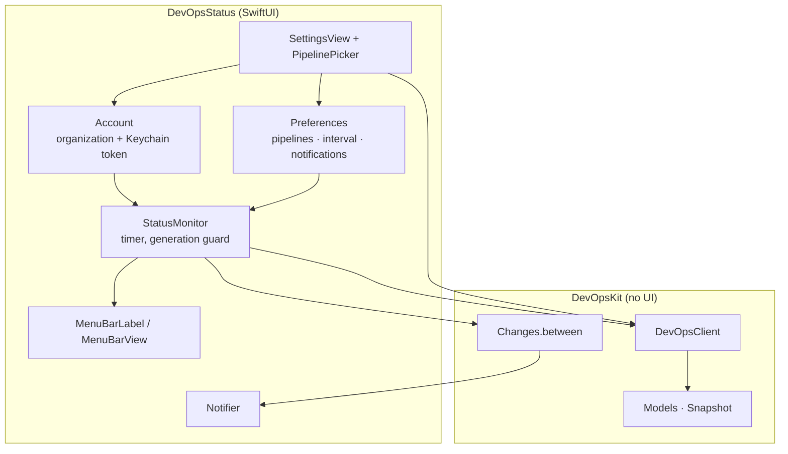

# Architecture

DevOps Status is a menu bar app with no Dock icon. It polls the Azure DevOps REST API (version 7.1) with a personal access token and shows four sections: pull requests waiting for your review, your own pull requests, watched pipelines, and work items assigned to you.



## Targets

| Target | Responsibility |
| --- | --- |
| `DevOpsKit` | Organization URL parsing, REST client, response decoding, classification (`Severity`, `ReviewState`, `CheckState`), change detection and the self-check. Imports only Foundation. |
| `DevOpsStatus` | SwiftUI menu bar extra, settings window, Keychain storage, notifications, login item, `--once` and `--render-screenshots` modes. |
| `DevOpsKitTests` | Runs `SelfCheck.run()` through XCTest. |

## Polling

`StatusMonitor.tick()` runs on launch, on a timer (30 s – 5 min, default 60 s), after **Connect** and when the watched pipelines change. Each tick increments a generation counter; results from an older tick are dropped so a slow request can't overwrite newer data.

`DevOpsClient.snapshot(pipelines:)` first resolves the signed-in user (`GET /_apis/connectionData`). If that fails, the whole tick fails: an invalid token is shown as a setup error, anything else keeps the previous snapshot and marks it offline. The four sections then load concurrently, and each one catches its own error so a missing scope or a timeout affects only that section.

## Sections

### To review

`GET /_apis/git/pullrequests?searchCriteria.reviewerId=<me>&searchCriteria.status=active&$top=200` at organization level, so every project is covered with one request. A pull request counts as waiting when:

- you are listed as a reviewer yourself (not only through a group),
- your vote is `0`,
- you haven't declined the review,
- it isn't a draft and you aren't its author.

### My pull requests

`GET /_apis/git/pullrequests?searchCriteria.creatorId=<me>&searchCriteria.status=active`. For each PR the build policy is read from `GET /<projectId>/_apis/policy/evaluations?artifactId=vstfs:///CodeReview/CodeReviewId/<projectId>/<prId>`, matching the *Build* policy type id `0609b952-1397-4640-95ec-e00a01b2c241` so it works in every UI language. When several build policies apply, the worst state wins (`failed > running > queued > none > passed`).

Review state, from the reviewers' votes:

| State | Rule |
| --- | --- |
| Rejected | any vote is `-10` |
| Waiting for author | any vote is `-5` |
| In review | a required person hasn't approved, or nobody has approved yet |
| Approved | otherwise |

Severity: conflicts (`mergeStatus == conflicts`), a failed build or a rejection are **critical**; waiting for author is **attention**.

### Pipelines

You choose pipelines per project in Settings; they are stored as `PipelineRef` (project id and name, definition id, folder path + name). For each project, in chunks of 50 definitions, two requests run in parallel:

1. newest run: `maxBuildsPerDefinition=1&queryOrder=queueTimeDescending`
2. newest finished run: the same with `statusFilter=completed&queryOrder=finishTimeDescending`

Both use `reasonFilter` with every CI reason except `pullRequest`, so a broken feature branch PR doesn't turn `main` red. The result shown is from the newest finished run; *Running* is added when the newest run hasn't finished yet.

### Work items

```sql
SELECT [System.Id] FROM WorkItems
WHERE [System.AssignedTo] = @Me
  AND [System.State] NOT IN ('Closed', 'Done', 'Removed', 'Resolved', 'Completed', 'Cut')
ORDER BY [System.ChangedDate] DESC
```

posted to `/_apis/wit/wiql?$top=50`, followed by `/_apis/wit/workitemsbatch` for title, type, state, project, priority and changed date. The WIQL order is preserved.

## Badge and colors

`Snapshot.badgeCount` = pull requests to review + failed pipelines.

| Color | When |
| --- | --- |
| Red | a watched pipeline failed, or one of your PRs is rejected, conflicting or has a failed build |
| Orange | reviews are waiting, a PR is waiting for you as author, or a pipeline partially succeeded; also when the app isn't set up |
| Default | nothing needs you |

## Notifications

`Changes.between(previous, current)` compares two snapshots. Nothing is announced on the first snapshot after launch, and a section is only compared when it loaded without error in both snapshots, so recovering from an outage doesn't replay old items.

| Change | Trigger |
| --- | --- |
| Review requested | a PR id appears in *To review* |
| Vote | a person's vote on one of your existing PRs changes to a non-zero value |
| Pipeline failed | a watched pipeline's result becomes *failed*, or a new run (different build number) fails again |
| Work item assigned | a work item id appears in *Work items* |

At most five notifications are posted per tick, followed by a summary. Clicking one opens the item in the browser.

## Authentication

The organization URL is normalized by `Organization`:

| Input | Stored as |
| --- | --- |
| `contoso` | `https://dev.azure.com/contoso` |
| `https://dev.azure.com/contoso/Project/_git/repo` | `https://dev.azure.com/contoso` |
| `https://contoso.visualstudio.com/...` | `https://contoso.visualstudio.com` |
| `https://tfs.example.com/tfs/DefaultCollection/_apis` | `https://tfs.example.com/tfs/DefaultCollection` |

The token goes into a generic Keychain item (service `<bundle id>.pat`, account = organization URL) after `connectionData` succeeds with it. Requests use HTTP Basic with an empty user name. Azure DevOps answers an invalid token with `401`, `203` or a redirect to an HTML sign-in page; all three become `DevOpsError.unauthorized` (`X-TFS-FedAuthRedirect-Suppress` is sent, and any non-JSON success is treated as unauthorized).

## Testing

`SelfCheck.run()` covers organization parsing, seven-digit fractional dates, vote mapping, pull request decoding and classification, build policy selection, pipeline result merging, work item decoding, query encoding and change detection. It runs with `--selftest`, `swift test`, and in CI on every push.

`--once` exercises the real API end to end with the saved connection or `--org` plus `AZURE_DEVOPS_EXT_PAT`.
